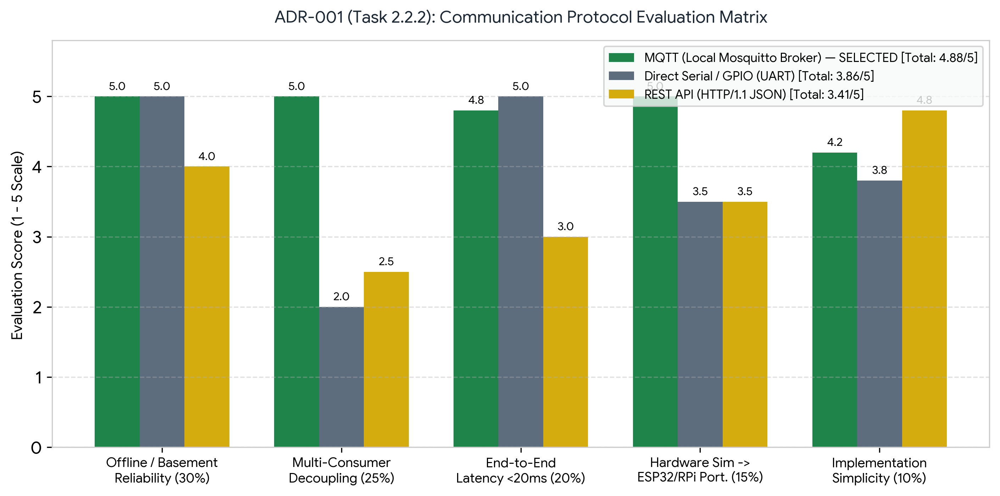

# ADR 001: Communication Protocol for the Smart Bin

- **Status:** Accepted
- **Date:** 2026-11-15
- **Author:** Danna Sanchez (DM)
- **Stakeholders:** Luis Olivera (LA), Natalia Ochoa (NM)
- **Related Tickets:** EDM-37, EDM-38

## 1. Context and Problem Statement

The edge inference application must deliver each waste-classification result to the smart-bin LED controller and bilingual German/English kiosk UI. The UI displays the German stream name, an English explanation and preparation guidance (for example, “Peel off aluminum lid”), and collects the student's answer to “Was this classification accurate?” for the Active Learning feedback pipeline. A local telemetry logger also consumes inference and delivery events.

The demonstrator is intended for student-residence waste rooms (*Müllraum*), including basements at Studentenwerk locations such as Alfons-Goppel-Platz and Wirthstraße, where internet, mobile service, and Wi-Fi may be absent or unreliable. Communication must therefore remain fully local and must not depend on cloud services. The experience target is under 500 ms from scan to visible result, with less than 20 ms allocated to local message transport.

The protocol must connect Python ML inference to multiple independent consumers, support feedback in the reverse direction, be simulatable on Linux without physical hardware, and remain portable to a Raspberry Pi or ESP32-based demonstrator. The five classifier streams remain Gelber Sack, Restmüll, Papier, Bioabfall, and Altglas, with an `UNSURE` outcome. Pfand/deposit-return indication is an actuator/UI behavior, not an additional trained class in this decision.

## 2. Decision Drivers

1. **Offline operation:** no cloud or external-network dependency; the local system must continue to classify and display results in an offline basement.
2. **Low latency:** local publish-to-consumer delivery must fit within a `< 20 ms` transport allocation.
3. **Pub/Sub decoupling:** one classification publisher must fan out to independent LED, kiosk, and telemetry consumers without embedding device-specific logic in the ML code.
4. **Bidirectional communication:** the kiosk must publish user feedback for the local Active Learning ingestion path.
5. **Simulation and portability:** run on Linux now, support software-only tests, and allow a path to Raspberry Pi and ESP32 hardware.

## 3. Options Considered

### Option A: MQTT over a Local Edge Broker (Mosquitto)

Run Mosquitto on the edge host and connect the inference publisher, LED adapter, kiosk, and telemetry logger as independent clients. The default single-device deployment uses `localhost`; no WLAN or internet connection is required. If components are later split across devices, they may use a private local network, but cloud connectivity is not part of this design.

MQTT provides lightweight hierarchical topics and broker-managed fan-out. Its fixed header is at least two bytes (before topic, packet identifier, and payload overhead), with configurable delivery QoS. QoS 1 provides at-least-once delivery and therefore requires duplicate-safe consumers. MQTT clients and a local Mosquitto service can be exercised on Linux; the optional serial bridge to a physical LED microcontroller remains behind an MQTT-subscribing adapter rather than replacing the bus.

### Option B: Direct Serial / UART / GPIO (`pyserial` / `RPi.GPIO`)

Direct serial/UART or GPIO can provide very low local latency and is useful for a hardware adapter. As the primary system protocol, however, it couples application code to a specific port or board. A raw serial connection is point-to-point; sending the same event to an LED and kiosk would require a custom multiplexer and message framing. Hardware-free laptop simulation and portability across board interfaces are also more difficult.

### Option C: REST API (HTTP/1.1 JSON over `localhost`)

A local FastAPI or Flask service is easy to inspect and debug, and HTTP/JSON is broadly supported. Its request/response model is less natural for independent event consumers and reverse-direction feedback. Fan-out would need additional mechanisms such as polling, webhooks, or a separate streaming channel; HTTP headers and request handling also add work that is unnecessary for this local event path. Persistent connections can reduce connection setup overhead but do not remove the need to design event delivery to multiple consumers.

## 4. Weighted Decision Matrix

Scores use a 1–5 scale, where 5 best satisfies the driver. Weighted points are `weight × score`; the total is divided by 100 to yield a score out of 5.

| Decision driver | Weight | MQTT / Mosquitto score | MQTT points | Serial / GPIO score | Serial points | REST score | REST points |
| --- | ---: | ---: | ---: | ---: | ---: | ---: | ---: |
| Offline operation | 30% | 5 | 150 | 5 | 150 | 5 | 150 |
| `< 20 ms` local transport target | 25% | 4 | 100 | 5 | 125 | 3 | 75 |
| Pub/Sub fan-out and decoupling | 20% | 5 | 100 | 1 | 20 | 2 | 40 |
| Bidirectional feedback | 15% | 5 | 75 | 2 | 30 | 4 | 60 |
| Linux simulation and hardware portability | 10% | 5 | 50 | 2 | 20 | 4 | 40 |
| **Total** | **100%** |  | **475 / 100 = 4.75** |  | **345 / 100 = 3.45** |  | **365 / 100 = 3.65** |

MQTT is selected because it combines offline local operation with native fan-out and reverse-direction feedback. Serial is faster in a direct point-to-point path, but would require custom multiplexing to meet the multi-consumer requirement. REST is viable for a local service but needs additional push/fan-out machinery.

## 5. Decision and Architecture Specification

**Use MQTT with a local Mosquitto broker as the primary communication bus.** The broker runs on the edge host and is reachable through loopback by default. Classification, LED control, kiosk display, and telemetry are independent MQTT clients. The system does not call a cloud broker or require external connectivity.

The classification publisher emits a canonical classification event. The kiosk subscribes to that event for German/English results and preparation tips. The LED actuation adapter consumes the event and publishes an explicit LED command; the LED controller subscribes to that command. The telemetry logger subscribes to classification, command, and health/latency telemetry as appropriate. The kiosk publishes user feedback to the feedback topic for local Active Learning ingestion.

| Topic | QoS | Publisher → subscribers | Purpose |
| --- | ---: | --- | --- |
| `smartbin/{bin_id}/classification` | 1 | Inference/decision publisher → LED actuation adapter, kiosk UI, telemetry logger | Canonical accepted classification or `UNSURE` event; drives result display and downstream actuation |
| `smartbin/{bin_id}/led/command` | 1 | LED actuation adapter → LED controller | Explicit channel/color and steady/blink command; blinking may indicate `UNSURE` or a separately recognized Pfand condition |
| `smartbin/{bin_id}/feedback` | 1 | Kiosk UI → feedback/Active Learning intake | Student accuracy response and optional correction reference, associated with the classification event |
| `smartbin/{bin_id}/telemetry` | 0 | Edge components → telemetry logger | Best-effort latency, delivery, and health measurements; telemetry loss must not block classification |

The exact payload schema, enums, and feedback fields are outside this protocol decision and must be specified and validated separately. QoS 1 is at-least-once, not exactly-once: event consumers must tolerate duplicate deliveries (for example, by using a stable event identifier once defined). Classification and actuation events must not be retained, to prevent stale commands from being replayed after reconnect; retained-state behavior, if needed for kiosk recovery, requires a separately defined state contract.

Measure transport latency with a monotonic clock from publish to each local subscriber's message-handler entry. The `< 20 ms` allocation applies to local delivery to the required consumers and must be verified on the target edge host; a publisher PUBACK alone does not prove that every subscriber handled the message. QoS 1 delivery, LED actuation, and kiosk rendering remain separately observable stages.

Mosquitto should bind to loopback in the single-host MVP. If a later deployment exposes the broker to a private LAN, restrict network access and apply broker authentication and per-topic ACLs; never expose it to the public internet. If an LED microcontroller cannot run an MQTT client, use a small MQTT subscriber-to-serial/USB bridge on the edge host. The bridge is an actuator adapter only; MQTT remains the application bus. Pfand indication is not a new classifier output: the UI/actuation path may blink for Pfand only when an independently supported rule or detector identifies it; otherwise use the existing `UNSURE` guidance.

## 6. Consequences, Trade-offs, and Mitigations

### Benefits

- Inference publishes one event without knowing the number or implementation of its consumers.
- LED, kiosk, and telemetry can subscribe independently; feedback travels back through a defined local topic.
- The default localhost deployment works without internet, mobile service, or WLAN and is reproducible on a Linux laptop.
- MQTT clients and the broker provide a migration path to a Raspberry Pi edge host and, where appropriate, ESP32-based devices.

### Trade-offs and risks

- The local Mosquitto service must be installed, started, and ready before connected clients can communicate.
- QoS 1 can deliver duplicates; consumers need idempotent handling.
- MQTT delivery and dispatch latency depend on broker/client scheduling and must be measured against the `< 20 ms` allocation.
- Separate physical consumers need a usable local link. A basement with no WLAN can use a co-located edge host or wired/USB actuator bridge; this ADR does not assume internet or cloud availability.
- QoS 0 telemetry can be lost, which is acceptable only because it is non-blocking operational data rather than a classification or actuation command.

### Mitigations

- Provide a broker health/readiness check and clear startup errors; do not silently report successful publication while the broker is unavailable.
- Provide an in-memory/mock MQTT client under `iot/` for unit tests and restricted environments, so tests can exercise publish/subscribe behavior without installing or starting Mosquitto. This test double is a planned mitigation, not an existing implementation.
- Test duplicate delivery handling and measure publish-to-handler latency for each required subscriber on the selected edge hardware.
- Keep the LED serial/USB bridge isolated behind an MQTT subscriber so it can be replaced by a simulated adapter or a native MQTT-capable controller.
