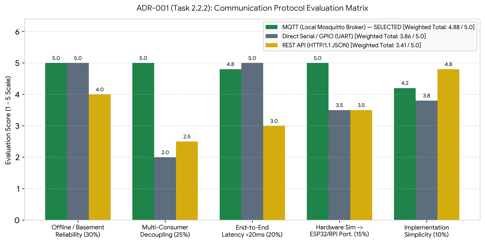

# Low-Confidence Fallback

When the classifier confidence is below the configured threshold, the decision layer must not present a waste-stream prediction as certain. It routes the result to `UNSURE`, shows guidance asking the user to check the item, and indicates the uncertain result with the designated blinking amber light.

