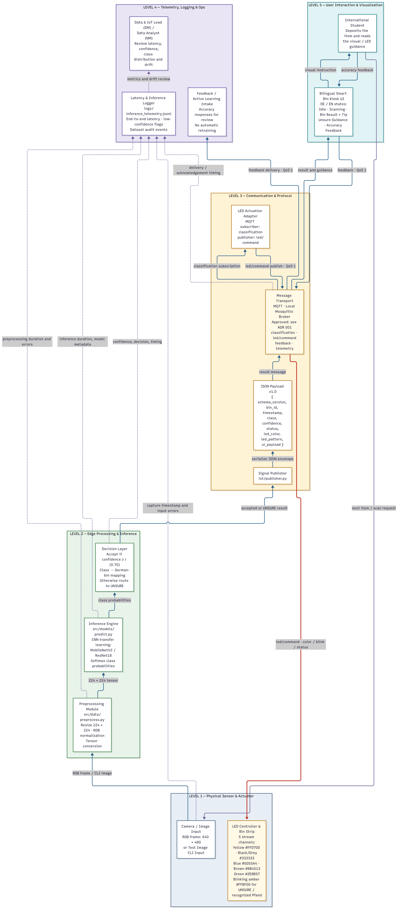
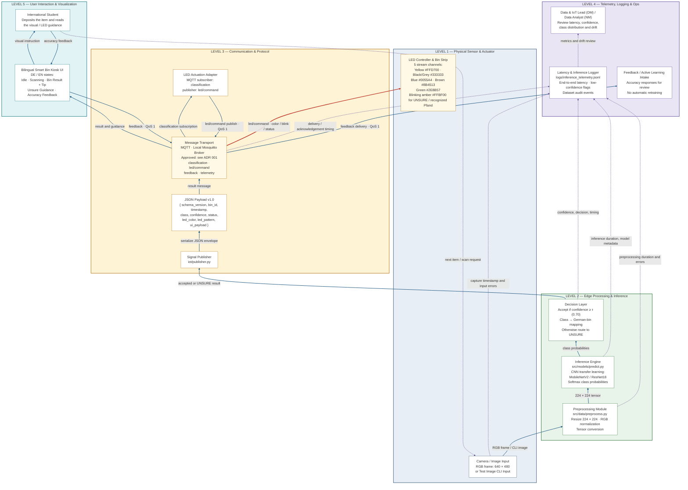

# Smart German Waste Classifier: System Architecture

## 1. Executive Overview and Pipeline Flow

This document defines the target architecture for a camera-assisted German household waste classifier and smart-bin demonstrator. The end-to-end pipeline is:

**Camera/Image Input → Preprocessing → Inference → Decision Layer → Signal Publisher → LED Controller and Kiosk UI**

The classifier recognizes five streams defined by the project: **Gelber Sack**, **Restmüll**, **Papier**, **Bioabfall**, and **Altglas**. It also exposes an explicit **UNSURE** state. A prediction is actionable only when its confidence meets the configured threshold; otherwise, the decision layer routes it to UNSURE rather than presenting a potentially misleading bin recommendation.

The camera supplies an RGB frame or a test image provided through the command line. Edge software validates and normalizes the image, runs a transfer-learning CNN, maps an accepted class to a German waste stream, then publishes a compact result for the physical indicator and kiosk. The kiosk presents bilingual German/English guidance, while telemetry records latency and low-confidence events for review.

The repository currently contains project documentation and source placeholders, but not the proposed `preprocess.py`, `predict.py`, `iot/publisher.py`, or telemetry implementation. The paths below are target module interfaces, not claims that those components have already been implemented. Communication is approved as MQTT over a local Mosquitto broker; see [ADR 001](adr_001_communication_protocol.md). The default deployment uses `localhost` and has no cloud dependency.

### Waste stream and indicator mapping

| Predicted stream | User-facing label | Indicator color |
| --- | --- | --- |
| `GELBER_SACK` | Gelber Sack | Yellow `#FFD700` |
| `RESTMUELL` | Restmüll | Black/grey `#333333` |
| `PAPIER` | Papier | Blue `#0055A4` |
| `BIOABFALL` | Bioabfall | Brown `#8B4513` |
| `ALTGLAS` | Altglas | Green `#2E8B57` |
| `UNSURE` | Unsure / Bitte prüfen | Blinking amber `#FFBF00` |

The Altglas green is the demonstrator's stream indicator; it does not replace local white/green/brown glass sorting guidance described in the project business-understanding document.

## 2. Layered System Architecture Diagram

The diagram is bottom-up (`flowchart BT`): physical inputs and outputs are at Level 1, and the user interaction layer is at Level 5. Solid arrows indicate data/result flow, thick arrows indicate actuation commands, and dotted arrows indicate monitoring/telemetry.





### JSON result envelope

The versioned contract and field constraints are defined in [the signal message specification](signal_message_format.md) and its JSON Schema. This example uses the classification signal field names:

```json
{
  "schema_version": "1.0",
  "bin_id": "bin-01",
  "timestamp": "2026-11-15T21:24:28.319Z",
  "class": "PAPIER",
  "confidence": 0.92,
  "status": "RESULT",
  "led_color": "#0055A4",
  "led_pattern": "SOLID",
  "ui_payload": {
    "label_de": "Papier",
    "label_en": "Paper & cardboard",
    "action_tip": {
      "de": "Sauber und trocken.",
      "en": "Keep clean and dry."
    }
  },
  "latency_ms": 143
}
```

`class` is one of the five stream identifiers or `UNSURE`; `confidence` is in the inclusive range 0–1. `status` distinguishes a normal result from an unsure/fallback result. The contract, bilingual UI fields, and class-to-LED constraints are specified in `docs/signal_message_format.md`.

## 3. Detailed Stage-by-Stage Interface Specification

| Stage | Module path | Input format | Processing logic | Output format | Failure / fallback handling |
| --- | --- | --- | --- | --- | --- |
| Camera | Camera adapter (hardware path TBD); CLI test-image entry point | RGB frame, 640 × 480, or local image path for test mode | Acquire one frame; validate readability, dimensions, and color channels; attach capture time | Validated RGB image plus capture timestamp | Reject unreadable or malformed input; do not infer; show capture guidance and record an input error |
| Preprocessing | `src/data/preprocess.py` (target) | Validated RGB image | Resize to 224 × 224; apply model-compatible RGB normalization; convert to tensor and add batch dimension | Model input tensor with expected dtype and shape | Surface validation/preprocessing error; do not reuse a stale frame; route the current scan to UNSURE/error guidance |
| Inference | `src/models/predict.py` (target) | Preprocessed tensor and loaded MobileNetV2 or ResNet18 transfer-learning model | Run one forward pass; obtain Softmax class probabilities; retain top class, confidence, and inference duration | Class-probability vector and inference metadata | Model unavailable or inference error must not produce a normal bin result; emit an error/UNSURE outcome, log diagnostic context, and keep the system responsive |
| Decision Layer | Edge decision component (module path TBD) | Class-probability vector and configured threshold `τ = 0.70` | Select top class; accept only when top confidence is at least `τ`; map class to the German stream and configured indicator color | Typed decision: stream, confidence, color, status (`RESULT` or `UNSURE`) | Below-threshold or unmapped class routes to `UNSURE` and blinking amber; never silently coerce to another stream |
| Signal Publisher | `iot/publisher.py` (target) | Typed decision, bin identifier, timestamp, and status | Build the JSON envelope and publish the classification event to `smartbin/{bin_id}/classification` through local Mosquitto at QoS 1 | Published MQTT event plus broker delivery outcome | Report serialization/broker failures to telemetry; do not show a successful delivery; QoS 1 is at-least-once, so consumers must tolerate duplicates |
| LED Controller | Hardware driver / simulator (selection TBD) | QoS 1 MQTT command on `smartbin/{bin_id}/led/command`, containing stream/status and `led_color` | Select one of five steady stream channels or a blinking state for `UNSURE` / recognized Pfand; apply the state and report completion if supported | LED state / acknowledgement | On invalid command or actuator fault, avoid presenting a wrong color, expose an indicator error to the kiosk, and log the failure; exact safe state is hardware-dependent |

## 4. End-to-End Latency Budget

The initial demonstrator target is **less than 500 ms from capture start to visible kiosk result and LED activation** for a warm, already-loaded model and a single-image request. Local MQTT message transport is allocated **less than 20 ms**. These are design budgets to be measured on the selected edge hardware, not benchmark results.

| Layer / stage | Budget (ms) | Technical rationale |
| --- | ---: | --- |
| Camera capture and frame validation | 50 | Single 640 × 480 frame; excludes camera startup and user dwell time |
| Preprocessing | 70 | Resize, normalize, and construct one input tensor |
| CNN inference | 250 | Dominant compute cost; assumes a warm MobileNetV2 or ResNet18 model on the chosen edge target |
| Decision and stream mapping | 10 | Top-class selection, threshold check, and deterministic mapping |
| Serialization, publisher, and MQTT transport | 19 | JSON envelope and local Mosquitto delivery to each required subscriber; target `< 20 ms`, not yet benchmarked |
| LED command, kiosk render, and visible activation | 30 | Local output update and initial result presentation |
| **Allocated total** | **429** | Sum of stage budgets |
| **Engineering margin** | **71** | Remaining allowance below the 500 ms target |
| **End-to-end target** | **< 500** | Capture start through visible kiosk result and LED activation |

Measure end-to-end duration with a monotonic clock and report stage durations separately. Measure message delivery from publish to each subscriber handler (a broker PUBACK alone does not confirm subscriber handling). Cold model loading, camera initialization, a broker readiness failure, or slow subscriber processing can exceed this budget; the local MQTT path and hardware must be benchmarked before the target is treated as verified.

## 5. Open Architecture Verification Items

| Sprint 2 task | Decision / verification item | Required evidence or exit condition |
| --- | --- | --- |
| **2.2.2 — Protocol ADR (Accepted)** | MQTT with local Mosquitto is selected; validate QoS 1 fan-out to LED and kiosk, feedback delivery, duplicate handling, and local broker recovery | See [ADR 001](adr_001_communication_protocol.md); benchmark publish-to-handler delivery against the `< 20 ms` allocation |
| **2.2.3 — Signal Message Format (Defined)** | The v1.0 classification payload and Draft-07 schema are defined; validate producer/consumer behavior and feedback correlation | See [signal message format](signal_message_format.md) and `iot/schemas/classification_signal.schema.json`; run schema and application validation tests |
| **2.2.4 — Confidence Threshold Calibration** | Validate the proposed `τ = 0.70` against validation data and the cost of a wrong-bin recommendation versus an UNSURE result | Calibration report with per-class behavior and a justified operating threshold |
| **2.2.5 — Hardware Simulator Selection** | Select the LED controller and development simulator; verify five stream channels plus blinking amber, command acknowledgement, and safe failure behavior | Recorded hardware/simulator choice and a repeatable actuation test |
| **2.3.4 — UI Feasibility Review** | Confirm kiosk display platform, DE/EN copy, accessibility/readability, and feasibility of Idle, Scanning, Bin Result + Tip, and Unsure Guidance states | Reviewed UI flow/prototype and confirmed integration interface |
